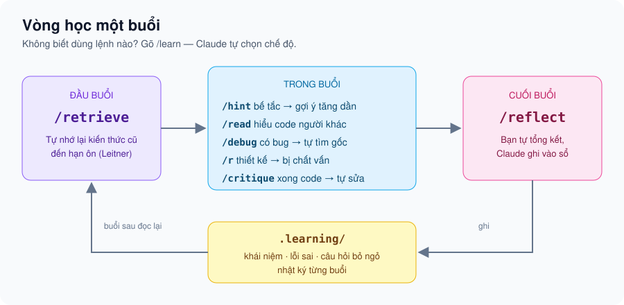
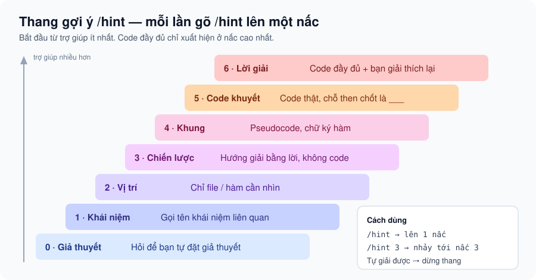

<p align="center"></p>

<p align="center">
  <b>Tiếng Việt</b> · <a href="#english">English</a>
</p>

# Claude Tutor Skills

Bộ 8 skill cho [Claude Code](https://claude.com/claude-code) giúp **bạn học lập trình thật sự** thay vì để AI viết code hộ.

Khi AI giải hộ mọi thứ, bạn có code chạy được nhưng không giữ lại kỹ năng nào. Bộ skill này đổi vai Claude thành **người thầy**. Khi bạn bế tắc, Claude đưa gợi ý theo từng nấc. Khi có bug, Claude hỏi ngược lại để bạn tự tìm ra nguyên nhân. Khi bạn lên thiết kế, Claude chất vấn như một giám khảo. Cuối buổi, những gì bạn học được, kể cả lỗi sai, được ghi vào sổ để buổi sau ôn lại.

> Chậm hơn một chút mỗi lần, nhưng bạn tiến xa hơn nhiều sau vài tháng.

## Các lệnh

| Lệnh | Chế độ | Dùng khi |
|---|---|---|
| `/learn` | Bộ định tuyến | Không biết nên dùng lệnh nào. Claude tự chọn và cho bạn biết đã chọn gì. `/learn off` để thoát |
| `/retrieve` | Ôn tập | Đầu buổi: ôn lại khái niệm và lỗi sai đến hạn bằng cách tự nhớ lại |
| `/hint [0-6]` | Thang gợi ý | Bế tắc: gợi ý tăng dần, code đầy đủ chỉ có ở nấc 6 |
| `/read` | Đọc code | Cần hiểu code trên mạng hoặc của người khác: dự đoán → chạy → khảo sát → sửa |
| `/debug` | Gia sư gỡ lỗi | Có bug: mong đợi so với thực tế → giả thuyết → thí nghiệm → nguyên nhân gốc |
| `/r` | Giám khảo | Lên kế hoạch hay thiết kế: bị chất vấn đến khi ra được một bản đặc tả chặt chẽ |
| `/critique` | Đánh giá code | Vừa viết xong: nhận nhãn mức độ nghiêm trọng và câu hỏi gợi mở, không bị viết lại hộ |
| `/reflect` | Tổng kết | Cuối buổi: bạn tự tổng kết, Claude ghi vào sổ `.learning/` |

<p align="center"></p>

## Thang gợi ý

<p align="center"></p>

Mỗi nấc cho **lượng trợ giúp tối thiểu** để bạn tự đi tiếp. Claude tự tìm ra lời giải trước nhưng không nói ra; mọi gợi ý đều dẫn về đúng chỗ then chốt mà bạn đang thiếu.

## Ví dụ thật

Các đoạn dưới đây trích từ lần chạy kiểm thử (rút gọn). File `cart.py` có lỗi `range(1, n)` nên bỏ sót phần tử đầu tiên.

**`/hint cart.py in ra 20.0 nhưng tôi mong đợi 120.0`**

> **Gợi ý cấp 0/6 — Giả thuyết**
>
> Bạn có hai món hàng, giá 100 và 20, và tổng in ra là 20.0. Con số 20.0 trùng với giá của món nào trong giỏ? Từ đó, bạn đoán xem món nào đã được cộng vào tổng và món nào chưa?
>
> 👉 Viết ra 1–2 câu giả thuyết của bạn. *(Vẫn kẹt? Gõ /hint để lên cấp 1.)*

**`/critique users.py`** (file có lỗ hổng SQL injection)

> **[NGHIÊM TRỌNG] users.py:5 — SQL injection.** Chuỗi `username` được nối thẳng vào câu SQL. Nếu ai đó nhập `' OR '1'='1`, câu truy vấn trả về user đầu tiên trong bảng. Bạn tự viết bản sửa nhé.
> ❓ `sqlite3` cho phép đưa giá trị vào câu truy vấn mà không cần nối chuỗi. Cơ chế đó tên là gì?
>
> **[QUAN TRỌNG] users.py:7 — Crash khi không tìm thấy user.**
> ❓ Nếu `username` không có trong bảng thì `fetchone()` trả về gì? Dòng 7 sẽ xảy ra điều gì?

**`/learn mình copy đoạn debounce trên stackoverflow mà không hiểu`**

> → Chế độ Đọc code có dẫn dắt (`/read`)
>
> **Bước 1 – Dự đoán.** Lướt qua đoạn code trong 1 phút. Theo bạn, `debounce` dùng để làm gì? Trả lời một câu thôi, đoán sai cũng không sao.

## Cài đặt

### Cách 1: Cài vào máy, gõ lệnh ngắn (khuyên dùng)

```bash
git clone https://github.com/khanhmoiii/claude-tutor-skills.git
cd claude-tutor-skills
```

Windows (PowerShell):

```powershell
.\install.ps1
```

macOS / Linux:

```bash
./install.sh
```

Script chép 8 skill vào `~/.claude/skills/`. Nếu đã có skill trùng tên, script bỏ qua để không ghi đè; muốn ghi đè thì thêm `-Force` / `--force`. Khởi động lại Claude Code rồi gõ `/learn`.

Muốn chỉ dùng cho một dự án: chép thư mục `skills/*` vào `<dự-án>/.claude/skills/`.

### Cách 2: Cài dạng plugin

Trong Claude Code:

```
/plugin marketplace add khanhmoiii/claude-tutor-skills
/plugin install tutor@claude-tutor-skills
```

Lệnh khi đó có tiền tố plugin, ví dụ `/tutor:learn`, `/tutor:hint`.

## Sổ học tập `.learning/`

`/reflect` tạo thư mục này ở gốc dự án:

```
.learning/
├── concepts.md          # khái niệm, ghi bằng lời của bạn, kèm câu hỏi ôn
├── mistakes.md          # lỗi sai: triệu chứng, nguyên nhân gốc, cách nhận ra lần sau
├── open-questions.md    # câu hỏi chưa giải đáp
└── sessions/            # nhật ký từng buổi
```

Mỗi mục đi kèm một lịch ôn theo **hộp Leitner**. Nhớ rõ thì lên hộp, quên thì về Hộp 1. Khoảng cách giữa các lần ôn lần lượt là 1, 3, 7, 16 và 35 ngày. Lịch được tính bằng script [`leitner.py`](skills/retrieve/scripts/leitner.py) (chỉ dùng thư viện chuẩn của Python), nên Claude không phải tự nhẩm ngày:

```bash
python skills/retrieve/scripts/leitner.py due              # mục đến hạn hôm nay
python skills/retrieve/scripts/leitner.py grade C-20261022-01 nho   # nho | mo | quen
```

Nếu không muốn commit sổ học tập, thêm `.learning/` vào `.gitignore`.

## Cơ sở khoa học

| Nguyên lý | Áp dụng ở |
|---|---|
| **Assistance dilemma** — trợ giúp vừa đủ, không thừa không thiếu (Koedinger & Aleven, 2007) | Thang gợi ý `/hint` |
| **Testing effect** — tự nhớ lại giúp nhớ lâu hơn đọc lại (Roediger & Karpicke, 2006) | `/retrieve`, bước tự nhớ trong `/reflect` |
| **Spaced repetition** — hệ thống hộp Leitner | Lịch ôn trong `.learning/` |
| **Self-explanation** — tự giải thích sâu hơn nghe giải thích (Chi et al., 1989) | Nấc 6 của `/hint`, bước tóm tắt trong `/read` |
| **PRIMM** — Predict, Run, Investigate, Modify, Make (Sentance et al., 2019) | `/read` |
| **Productive failure** — vật lộn có định hướng trước khi được chỉ (Kapur, 2008) | `/debug`, `/hint` cấp thấp |
| **Metacognition** — đối chiếu điều mình tự thấy với thực tế | Bước tự đánh giá trong `/critique` |

## Nguyên tắc chung của mọi chế độ

- Claude **không viết lời giải hộ**. Ngoại lệ: nấc 6 của `/hint`, hoặc khi bạn nói rõ "cho tôi code luôn". Khi đó bạn sẽ được yêu cầu giải thích lại đoạn code.
- **Mỗi lượt một câu hỏi chính.**
- **Tình huống khẩn cấp** (sự cố production, mất dữ liệu, lỗ hổng bảo mật đang bị khai thác) thì Claude xử lý trực tiếp trước, rồi mới phân tích để học.
- Cú pháp và boilerplate được giải thích thẳng. Công sức của bạn dành cho khái niệm cốt lõi.

## Kiểm thử

- `tests/test_leitner.py`: 6 unit test cho lịch ôn (cộng ngày qua tháng, lên/xuống hộp, sinh ID). Chạy bằng `python -m unittest discover tests`.
- `tests/scenarios.md`: các kịch bản đã chạy với Claude thật trên dự án mẫu `tests/fixture/`, kèm hành vi mong đợi và các lỗi đã phát hiện và sửa.

## Tùy biến

Mỗi skill là một file Markdown trong `skills/<tên>/SKILL.md`. Bạn có thể sửa trực tiếp, ví dụ đổi số nấc gợi ý, thêm chiều chất vấn cho `/r`, hay đổi khoảng cách ôn trong `leitner.py`. Định dạng mục trong sổ được quy định ở `skills/reflect/SKILL.md` và `skills/retrieve/SKILL.md`; nếu sửa thì sửa ở cả hai nơi.

---

<a id="english"></a>

## English

**Claude Tutor Skills** turns Claude Code from a code-writer into a programming tutor. The skills are written in Vietnamese, but Claude replies in whatever language you use.

- `/learn`: router that picks the right mode for you. `/learn off` exits tutor mode.
- `/hint [0-6]`: hint ladder. It starts with questions that help you form a hypothesis and gives full code only at level 6.
- `/read`: guided code reading using PRIMM (predict, run, investigate, modify).
- `/debug`: Socratic debugging: expected vs actual, hypotheses, experiments, root cause, prevention.
- `/r`: design examiner. Claude interrogates your plan until it becomes a tight spec.
- `/critique`: code review with severity labels and guiding questions; Claude does not rewrite your code.
- `/reflect` and `/retrieve`: an end-of-session notebook in `.learning/`, then spaced-repetition review (Leitner boxes) at the start of the next session.

Install: clone the repo and run `install.ps1` (Windows) or `install.sh`, or add it as a plugin with `/plugin marketplace add khanhmoiii/claude-tutor-skills`.

## License

[MIT](LICENSE)
